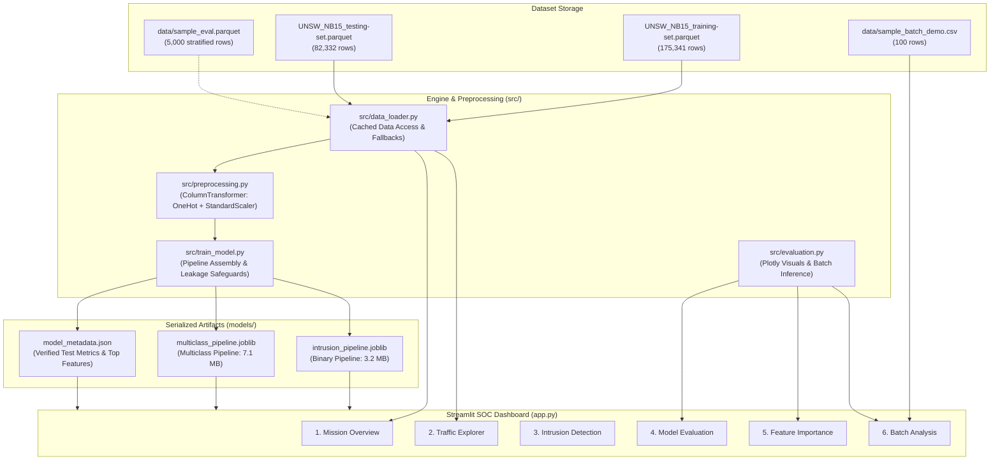

# Streamlit App for Network Intrusion Detection

[](https://www.python.org/)
[](https://streamlit.io/)
[](https://scikit-learn.org/)
[](#dataset-license--provenance)

> **An ML-powered network traffic analysis application for exploring intrusion patterns, evaluating detection models, and classifying network flows using the UNSW-NB15 benchmark dataset.**

---

## Table of Contents

- [Project Overview](#project-overview)
- [Feature Showcase](#feature-showcase)
- [System Architecture](#system-architecture)
- [Repository Structure](#repository-structure)
- [Dataset Documentation (UNSW-NB15)](#dataset-documentation-unsw-nb15)
- [Machine Learning Methodology](#machine-learning-methodology)
- [Evaluation & Benchmark Results](#evaluation--benchmark-results)
- [Installation & Local Setup](#installation--local-setup)
- [Model Training & Reproducibility](#model-training--reproducibility)
- [Streamlit Community Cloud Deployment](#streamlit-community-cloud-deployment)
- [Security, Privacy & Responsible Use](#security-privacy--responsible-use)
- [Limitations & Future Work](#limitations--future-work)
- [Troubleshooting](#troubleshooting)
- [Contribution & Project Status](#contribution--project-status)

---

## Project Overview

Modern Security Operations Centers (SOCs) face overwhelming volumes of network telemetry. Identifying malicious behaviors—ranging from stealthy reconnaissance sweeps to volumetric Denial of Service (DoS) floods—demands automated analytical tooling capable of processing complex flow metrics without introducing operational latency.

### The Problem
Traditional rule-based intrusion detection systems (IDS) rely heavily on static signature databases. While effective against known attacks, signature matching struggles against polymorphic variants, zero-day behaviors, and multi-stage attack cadences. Machine learning models trained on network flow metadata offer complementary anomaly and pattern-detection capabilities.

### What This Application Demonstrates
This project implements a complete, end-to-end Machine Learning web application designed to bridge raw network security research with interactive operational interfaces:
- **Offline Flow Analysis:** Evaluates network connection flows generated from the benchmark **UNSW-NB15** cybersecurity dataset.
- **Leakage-Free ML Architecture:** Implements reproducible `scikit-learn` pipelines fitted strictly on official training partitions and evaluated on independent held-out test data.
- **Explainable Anomaly Attribution:** Visualizes feature importance scores derived directly from tree ensemble classifiers.
- **Interactive Security Analytics:** Provides an operator-friendly dark cyberpunk dashboard featuring single-flow tactical inspection, multidimensional telemetry filtering, and bulk CSV batch auditing.

### Intended Audience & Scope
- **Security Analysts & SOC Teams:** To explore how flow metrics (such as packet inter-arrival times, payload ratios, and connection frequency counts) translate into statistical threat risk scores.
- **Machine Learning Engineers & Data Scientists:** As a reference implementation of leakage-free tabular preprocessing, class-imbalance mitigation, and model serialization within Streamlit.
- **Students & Cybersecurity Researchers:** As an interactive educational platform for studying intrusion telemetry signatures without configuring physical network hardware.

> [!NOTE]
> **Defensive Scope Notice:** This application is strictly an **offline diagnostic and analytical tool** operating on static network flow records. It does **not** perform real-time packet capturing, physical network interface promiscuous sniffing, or live intrusion prevention.

---

## Feature Showcase

The dashboard is structured into six focused analytical workspaces accessible via the sidebar console:

### 1. Mission Overview
- **Purpose:** High-level operational summary of traffic telemetry and threat exposure.
- **Key Visuals & Metrics:**
  - KPI metric cards displaying Total Analyzed Records, Intrusion Attacks Flagged, Benign Flows, and Monitored Protocols/Services.
  - Interactive attack category volume distribution bar chart (Normal vs. 9 attack categories).
  - High-contrast traffic class proportion donut chart illustrating binary class balance.
  - Active dataset partition and storage verification status.

### 2. Traffic Explorer
- **Purpose:** Multidimensional visual inspection of network flows to uncover malicious behavioral patterns.
- **Interactive Controls:**
  - Dynamic filtering by **Protocol** (`proto`: `tcp`, `udp`, `arp`, etc.), **Connection State** (`state`: `FIN`, `INT`, `CON`, `REQ`, etc.), and **Attack Category** (`attack_cat`).
  - Packet rate threshold slider to isolate high-cadence automated flows from interactive human traffic.
- **Analytics:**
  - Interactive bivariate scatter plot with user-selectable X and Y numerical axes (e.g., Source Bytes vs. Destination Bytes), colored by ground-truth intrusion status.
  - Feature distribution histogram with marginal box plots to inspect data skew and outliers.
  - Filterable raw sample flow table.

### 3. Intrusion Detection (Real-Time Flow Inspector)
- **Purpose:** Tactical single-flow threat inference engine.
- **Flow Input Parameters:** Form fields organized into three logical groups:
  - *Network Protocol & State:* `proto`, `service`, `state`, flow duration (`dur`), and packet transmission rate (`rate`).
  - *Packet & Byte Volumes:* Source/destination packet counts (`spkts`, `dpkts`), byte counts (`sbytes`, `dbytes`), and mean packet sizes (`smean`, `dmean`).
  - *Throughput & TCP Dynamics:* Source/dest bit rates (`sload`, `dload`), connection counts to same port (`ct_src_dport_ltm`, `ct_dst_sport_ltm`), and TCP window sizes (`swin`, `dwin`).
- **Pre-Configured Scenarios:** Quick-load buttons for rapid testing:
  - `🟢 Benign HTTP Web Flow`: Standard two-way TCP conversation with balanced payload exchanges.
  - `🔴 SYN Flood DoS Attack`: High-rate unidirectional flow with minimal packet size and unacknowledged states.
  - `🟣 Exploits / Shellcode Payload`: Elevated source payload averages and abnormal HTTP transaction depths.
  - `🟡 Reconnaissance Scan`: High destination port frequency sweep across brief intervals.
- **Inference Outputs:**
  - Binary threat verdict banner (`🚨 INTRUSION ATTACK DETECTED` vs. `✅ BENIGN NORMAL TRAFFIC`).
  - Threat probability percentage gauge with colored risk tier indicator.
  - Secondary multiclass classification identifying the specific attack vector (e.g., `Exploits`, `DoS`, `Fuzzers`).

### 4. Model Evaluation
- **Purpose:** Transparent, uninflated verification of model accuracy using the independent held-out test partition (82,332 records).
- **Reported Metrics:** Test ROC-AUC (0.9789), Attack Recall (94.65%), Attack Precision (87.57%), F1-Score (90.97%), and Overall Accuracy (89.65%).
- **Visual Diagnostics:**
  - Interactive Confusion Matrix heatmap explicitly breaking down True Negatives (30,907), False Positives (6,093), False Negatives (2,425), and True Positives (42,907).
  - Glowing neon Receiver Operating Characteristic (ROC) curve plotted against a random baseline.
  - Complete `scikit-learn` classification report detailing per-class precision, recall, and support.

### 5. Feature Importance
- **Purpose:** Model explainability and feature attribution.
- **Attribution Method:** Tree-based Mean Decrease in Impurity (MDI) computed from the fitted Random Forest classifier.
- **Visuals & Domain Context:**
  - Horizontal bar chart ranking the top 15 predictive flow features.
  - Cybersecurity interpretation table explaining the physical security relevance of key indicators (e.g., why `dload`, `dmean`, and `ct_dst_sport_ltm` correlate with anomalous activity).

### 6. Batch Analysis
- **Purpose:** Bulk audit of network flow exports.
- **Workflow:**
  - File uploader accepting CSV files, with a one-click **Load Bundled Demo Batch** button (pre-loads a verified 100-flow sample).
  - Automated schema validation reporting missing or surplus columns and applying deterministic default values for missing inputs.
  - Bulk inference engine computing risk probabilities, binary verdicts, threat tiers (`CRITICAL`, `HIGH`, `ELEVATED`, `LOW`, `BENIGN`), and predicted attack categories.
  - Summary KPI cards displaying total flows, detected threats, and incident rates.
  - Filterable audit table with one-click **Download Audit Report (Enriched CSV)**.

---

## System Architecture

The following diagram outlines the data flow, model pipelines, and UI integration:



### Module Responsibilities

| Module | Location | Primary Responsibilities |
| :--- | :--- | :--- |
| `app.py` | Root | Streamlit presentation layer, custom cyberpunk CSS styling, multi-page routing, state caching, and user event handling. |
| `src/preprocessing.py` | `src/` | Canonical definitions of 34 flow features, `ColumnTransformer` constructor (handling unseen categories), dataframe cleaning, and input validation. |
| `src/data_loader.py` | `src/` | File discovery across multiple candidate paths, cached reading of parquet/CSV, stratified sampling, and graceful fallback handling. |
| `src/train_model.py` | `src/` | Independent training script executing train/test split isolation, model fitting, metric computation, and artifact serialization. |
| `src/evaluation.py` | `src/` | High-contrast Plotly chart factories (confusion matrix, ROC, distributions, feature importance) and vectorized batch inference. |
| `src/generate_demo_samples.py`| `src/` | Utility script generating lightweight fixtures (`data/sample_eval.parquet` and `data/sample_batch_demo.csv`) for deployment without the full dataset. |

---

## Repository Structure

```
.
├── .gitignore                    # Excludes massive datasets, virtualenvs, and pycache
├── .pytest_cache/                # Pytest runtime cache
├── .streamlit/
│   └── config.toml               # Cyberpunk dark theme configuration & server settings
├── data/
│   ├── sample_batch_demo.csv     # 100-flow demo file for batch analysis testing (16 KB)
│   └── sample_eval.parquet       # 5,000-flow stratified test subset for cloud deployment (315 KB)
├── models/
│   ├── intrusion_pipeline.joblib # Trained binary classification pipeline (3.2 MB)
│   ├── multiclass_pipeline.joblib# Trained 10-class attack classifier pipeline (7.1 MB)
│   └── model_metadata.json       # Exact training parameters, benchmark metrics, and feature ranks
├── src/
│   ├── __init__.py               # Package initializer
│   ├── data_loader.py            # Dataset resolution, loading, and sampling
│   ├── evaluation.py             # Plotly chart generators and batch inference utilities
│   ├── generate_demo_samples.py  # Fixture generation script
│   ├── preprocessing.py          # ColumnTransformer pipelines and schema validation
│   └── train_model.py            # Reproducible model training and evaluation script
├── tests/
│   ├── test_data_loader.py       # Unit tests for data loading and summary stats
│   ├── test_prediction.py        # Unit tests for model loading and batch predictions
│   └── test_preprocessing.py     # Unit tests for schema validation and out-of-vocabulary handling
├── app.py                        # Streamlit multi-page web application
├── pytest.ini                    # Pytest configuration (pythonpath = .)
├── README.md                     # Comprehensive project documentation
└── requirements.txt              # Pinned, compatible production dependencies
```

---

## Dataset Documentation (UNSW-NB15)

### Dataset Provenance & Citation
The **UNSW-NB15** dataset was created by Nour Moustafa and Jill Slay at the Cyber Range Lab of the **Australian Centre for Cyber Security (ACCS)** at the University of New South Wales (UNSW Canberra at the Australian Defence Force Academy).

- **Academic Citation:**  
  *Moustafa, Nour, and Jill Slay. "UNSW-NB15: a comprehensive data set for network intrusion detection systems (UNSW-NB15 network data set)." 2015 Military Communications and Information Systems Conference (MilCIS). IEEE, 2015.*
- **Official Dataset Portal:** [UNSW Canberra Research Repository](https://research.unsw.edu.au/projects/unsw-nb15-dataset)

### Partitions & File Formats
The dataset is utilized in optimized columnar Apache Parquet (`.parquet`) format:
- **Official Training Partition (`UNSW_NB15_training-set.parquet`):** **175,341** records (9.17 MB on disk).
- **Official Testing Partition (`UNSW_NB15_testing-set.parquet`):** **82,332** records (4.33 MB on disk).
- **Total Flow Records:** 257,673 across both partitions.
- **Null / Missing Value Audit:** **0 null values** across all columns in both partitions.

### Input Features (34 Flow Features)
The model strictly ingests 34 network flow features:

| Category | Count | Feature Names | Description |
| :--- | :---: | :--- | :--- |
| **Categorical** | 3 | `proto`, `service`, `state` | Protocol (133 types in train), application service (13 types), and connection state. |
| **Flow Dynamics**| 9 | `dur`, `rate`, `sinpkt`, `dinpkt`, `sjit`, `djit`, `tcprtt`, `synack`, `ackdat` | Connection duration, packet rate, inter-packet arrival times, jitter, and TCP round-trip latency. |
| **Volume Metrics**| 16| `spkts`, `dpkts`, `sbytes`, `dbytes`, `sload`, `dload`, `sloss`, `dloss`, `swin`, `dwin`, `stcpb`, `dtcpb`, `smean`, `dmean`, `trans_depth`, `response_body_len` | Packet counts, byte counts, bitrates, retransmissions, TCP window advertisements, sequence baselines, payload sizes, and HTTP transaction depths. |
| **Tracking Counts**| 6 | `ct_src_dport_ltm`, `ct_dst_sport_ltm`, `is_ftp_login`, `ct_ftp_cmd`, `ct_flw_http_mthd`, `is_sm_ips_ports` | Frequency tracking features across 100-connection windows, FTP state flags, HTTP method indicators, and IP/port matching flags. |

### Target Definitions & Class Distribution

The dataset provides two distinct targets:
1. **Binary Target (`label`):**
   - `0`: Normal / Benign network flows.
   - `1`: Intrusion Attack.
2. **Multiclass Target (`attack_cat`):** 10 distinct classes.

#### Official Split Breakdown

| Target Label / Category | Training Set (175,341 rows) | Testing Set (82,332 rows) |
| :--- | :---: | :---: |
| **Normal (`label = 0`)** | **56,000 (31.94%)** | **37,000 (44.94%)** |
| **Attack (`label = 1`)** | **119,341 (68.06%)** | **45,332 (55.06%)** |
| — Generic | 40,000 | 18,871 |
| — Exploits | 33,393 | 11,132 |
| — Fuzzers | 18,184 | 6,062 |
| — Denial of Service (DoS) | 12,264 | 4,089 |
| — Reconnaissance | 10,491 | 3,496 |
| — Analysis | 2,000 | 677 |
| — Backdoor | 1,746 | 583 |
| — Shellcode | 1,133 | 378 |
| — Worms | 130 | 44 |

### Dataset Limitations & Known Biases
- **Class Imbalance in Attack Vectors:** While the binary split is well-balanced, rare attack categories (such as Worms with only 44 test samples) exhibit extreme class rarity compared to Generic or Exploits.
- **Synthetic Testbed Environment:** The flows were captured in the IXIA PerfectStorm simulated testbed in 2015. While representative of attack methodologies, baseline traffic patterns (e.g., protocol prevalence, average packet lengths) may differ from modern encrypted cloud traffic (e.g., TLS 1.3, QUIC/HTTP3).
- **State Space Shifts:** The held-out test split contains connection states (`CLO`, `ACC`) that do not exist in the training partition, requiring encoders that handle out-of-vocabulary categories gracefully.

---

## Machine Learning Methodology

### Leakage Prevention Architecture
Data leakage is a frequent flaw in network intrusion detection literature. This project enforces strict structural isolation:
1. **No Target Leakage:** Neither `label` nor `attack_cat` is included in the feature matrix $X$.
2. **No Surrogate Identifiers:** Row IDs, sequence indexes, and timestamp identifiers are excluded prior to model ingestion.
3. **Strict Train-Only Fitting:** The `ColumnTransformer` (computing standard scaler means/variances and one-hot category dictionaries) is **fitted strictly on `X_train`**. It transforms `X_test` and real-time inputs without re-fitting.
4. **Out-of-Vocabulary Robustness:** `OneHotEncoder(handle_unknown="ignore", sparse_output=False)` ensures that unseen test protocols or states do not crash inference or alter feature dimensions.

### Pipeline Pipeline Construction

The primary intrusion detection pipeline (`models/intrusion_pipeline.joblib`) is assembled via `sklearn.pipeline.Pipeline`:

```python
preprocessor = ColumnTransformer(
    transformers=[
        ("cat", OneHotEncoder(handle_unknown="ignore", sparse_output=False), CATEGORICAL_FEATURES),
        ("num", StandardScaler(), NUMERICAL_FEATURES),
    ],
    remainder="drop",
)

classifier = RandomForestClassifier(
    n_estimators=100,
    max_depth=16,
    min_samples_split=10,
    min_samples_leaf=4,
    class_weight="balanced",
    n_jobs=-1,
    random_state=42,
)

binary_pipeline = Pipeline([
    ("preprocessor", preprocessor),
    ("classifier", classifier),
])
```

- **Algorithm Choice:** A calibrated Random Forest ensemble (100 estimators) was chosen as an optimal baseline. It delivers strong non-linear decision boundaries across tabular flow features, resists overfitting through tree aggregation, and executes inference in under 1 millisecond per flow.
- **Hyperparameter Constraints:** Constraining `max_depth=16` and setting `min_samples_leaf=4` prevents leaf node explosion, ensuring the serialized model artifact remains compact (**3.2 MB**), easily adhering to Streamlit Cloud memory limits.
- **Class Weighting:** `class_weight="balanced"` dynamically weights the loss function inversely proportional to class frequencies during tree construction.

---

## Evaluation & Benchmark Results

The metrics below represent **actual, verified test results** computed on the official held-out UNSW-NB15 test partition (**82,332 records**). No training metrics are reported as test metrics.

### Primary Binary Classifier Performance

| Evaluation Metric | Score | Security & Operational Interpretation |
| :--- | :---: | :--- |
| **ROC-AUC** | **0.9789** | High discriminatory ability across all decision thresholds. |
| **Intrusion Recall** | **94.65%** | **Detection Rate:** Out of 45,332 real attack flows, the model detected **42,907**. |
| **Intrusion Precision** | **87.57%** | **Alert Reliability:** When an intrusion alert fires, it is valid 87.57% of the time. |
| **F1-Score** | **90.97%** | Harmonic balance between high recall and manageable false positive rate. |
| **Overall Accuracy** | **89.65%** | Total correct classifications across both normal and attack traffic. |

### Held-Out Confusion Matrix Breakdown

```
                       PREDICTED NORMAL    PREDICTED ATTACK
ACTUAL NORMAL (0)           30,907 (TN)          6,093 (FP)
ACTUAL ATTACK (1)            2,425 (FN)         42,907 (TP)
```

- **True Negatives (TN = 30,907):** Normal flows correctly classified as benign.
- **False Positives (FP = 6,093):** Normal flows mistakenly flagged as attacks (False Alarms).
- **False Negatives (FN = 2,425):** Malicious flows that evaded detection (Missed Threats).
- **True Positives (TP = 42,907):** Intrusions successfully intercepted.

### Per-Class Performance Breakdown

| Class | Precision | Recall | F1-Score | Held-Out Test Support |
| :--- | :---: | :---: | :---: | :---: |
| **Normal (`0`)** | 0.9272 | 0.8353 | 0.8789 | 37,000 |
| **Attack (`1`)** | 0.8757 | 0.9465 | 0.9097 | 45,332 |
| **Macro Average** | 0.9015 | 0.8909 | 0.8943 | 82,332 |
| **Weighted Average**| 0.8988 | 0.8965 | 0.8959 | 82,332 |

### Multiclass Classification Performance
The secondary multi-vector classifier achieves **65.87% overall test accuracy** across all 10 classes. Dominant categories (`Generic`, `Exploits`, `Normal`) demonstrate robust identification, whereas heavily underrepresented attack categories (`Worms` with $n=44$, `Analysis` with $n=677$) demonstrate the inherent difficulty of fine-grained classification on extreme long-tail distributions.

---

## Installation & Local Setup

### 1. System Requirements
- **Operating System:** Linux, macOS, or Windows (WSL2 recommended for Windows).
- **Python:** Python 3.10, 3.11, or 3.12.
- **Memory:** Minimum 4 GB RAM (8 GB recommended for full training).

### 2. Clone Repository & Create Environment

```bash
# Clone the repository
git clone https://github.com/<your-username>/<your-repo-name>.git
cd <your-repo-name>

# Create a clean virtual environment using Python 3.12
python3 -m venv .venv
source .venv/bin/activate

# Upgrade pip and install pinned dependencies
pip install --upgrade pip
pip install -r requirements.txt
```

*(Alternatively, if using [uv](https://github.com/astral-sh/uv)):*
```bash
uv venv --python 3.12
source .venv/bin/activate
uv pip install -r requirements.txt
```

### 3. Verify Installation with Unit Tests
Execute the automated test suite to confirm that data loaders, transformers, and inference pipelines are functional:

```bash
pytest -v
```
*Expected result:* 10 unit tests passing cleanly in ~1.5 seconds.

### 4. Launch the Streamlit Application
```bash
streamlit run app.py
```
Open **`http://localhost:8501`** in your web browser.

---

## Model Training & Reproducibility

Pre-trained model artifacts are included in `models/` so the app is ready for immediate execution. If you have the full UNSW-NB15 dataset and wish to re-train the models from scratch:

### 1. Dataset Placement
Ensure the official parquet files are located in one of the auto-discovery directories:
- `/home/<user>/UNSW-NB15/`
- `./data/`
- `~/UNSW-NB15/`

Filenames expected: `UNSW_NB15_training-set.parquet` and `UNSW_NB15_testing-set.parquet`.

### 2. Execute Training Script
```bash
python -m src.train_model
```

### 3. What the Training Script Does
1. Loads official training (175,341 rows) and testing (82,332 rows) splits.
2. Isolates 34 flow features, stripping target labels to guarantee zero leakage.
3. Fits the binary `ColumnTransformer` and 100-tree `RandomForestClassifier`.
4. Evaluates predictions on the held-out test split, printing accuracy, recall, precision, ROC-AUC, and the confusion matrix.
5. Fits the secondary 10-class multiclass attack classifier.
6. Serializes `models/intrusion_pipeline.joblib`, `models/multiclass_pipeline.joblib`, and `models/model_metadata.json`.

---

## Streamlit Community Cloud Deployment

This repository is optimized for deployment to **[Streamlit Community Cloud](https://share.streamlit.io/)**:

### 1. Deployment Architecture & File Size Strategy
- **Compact Artifacts:** The compressed binary model pipeline is **3.2 MB** and the multiclass pipeline is **7.1 MB**, easily remaining below GitHub's 100 MB hard limit.
- **Bundled Cloud Fixtures:** The full 14 MB raw dataset is ignored by `.gitignore`. Instead, `data/sample_eval.parquet` (315 KB) and `data/sample_batch_demo.csv` (16 KB) are tracked in the repository.
- **Graceful Fallbacks:** In cloud environments where raw external dataset files do not exist, `src/data_loader.py` automatically detects the bundled `sample_eval.parquet` and serves data without crashing.

### 2. Step-by-Step Deployment Guide
1. **Initialize Git Repository (if not already initialized):**
   ```bash
   git init
   git add .
   git commit -m "Initial commit: Streamlit App for Network Intrusion Detection"
   git branch -M main
   git remote add origin https://github.com/<your-username>/<your-repo-name>.git
   git push -u origin main
   ```
2. **Access Streamlit Community Cloud:**
   - Log in to [share.streamlit.io](https://share.streamlit.io) via your GitHub account.
3. **Configure New App:**
   - Click **New app**.
   - Select your repository and set `Branch` to `main`.
   - Set `Main file path` to `app.py`.
4. **Deploy:**
   - Click **Deploy!**. Streamlit Cloud will install dependencies from `requirements.txt` and launch the application.

---

## Security, Privacy & Responsible Use

### Intended Use
This software is intended as an **offline defensive analysis and cybersecurity research tool**. It assists practitioners in understanding the statistical manifestations of network intrusions.

### Limitations of Benchmark Models
- **Predictions are Probabilistic Estimates:** Model outputs reflect patterns learned from the 2015 UNSW-NB15 testbed. A classification verdict does not constitute forensic certainty of compromise.
- **No Active Network Defense:** The application does not deploy firewall rules, terminate sockets, or modify system configurations.
- **Threat Drift:** Evolving threat methodologies, sophisticated obfuscation, and zero-day vulnerabilities not represented in the 2015 dataset will not be detected reliably.

### Input Data Handling
- **Treat Uploaded Files as Untrusted:** The Batch Analysis interface sanitizes input headers, coerces data types, and drops unexpected attributes to prevent malformed injection.
- **Privacy Warning:** Do not upload production CSVs containing unencrypted personally identifiable information (PII), proprietary payload strings, or live corporate credentials to public cloud deployments.

---

## Limitations & Future Work

### Current Limitations
- **Static Flow Reliance:** Detection requires pre-computed flow summaries (`dur`, `sbytes`, `rate`, etc.). The system cannot process raw `.pcap` files on the fly.
- **Multiclass Long-Tail Rarity:** Classification accuracy on small classes (`Worms`, `Backdoor`) is bounded by low sample availability in the benchmark dataset.
- **Absence of Temporal Sequence Modeling:** The model treats each flow independently, without aggregating sequence history across recurring source IPs.

### Future Work Roadmap
- [ ] **PCAP Parsing Integration:** Integrate `scapy` or `dpkt` to parse raw `.pcap` packet capture files directly into the 34-feature schema in memory.
- [ ] **Temporal Flow Graph Analytics:** Incorporate sliding-window sequence tracking to detect distributed slow-and-low port scans across multiple source IPs.
- [ ] **Model Calibration:** Apply Platt scaling or isotonic regression to calibrate raw tree probabilities into well-calibrated confidence intervals.
- [ ] **SHAP TreeExplainer:** Implement local Shapley value water-fall plots for instant single-flow explainability in the Intrusion Detection view.

---

## Troubleshooting

| Issue | Root Cause | Solution |
| :--- | :--- | :--- |
| `FileNotFoundError: Testing dataset file not located` | Neither the full dataset nor `data/sample_eval.parquet` was found. | Ensure `data/sample_eval.parquet` exists, or run `python -m src.generate_demo_samples`. |
| `FileNotFoundError: Trained model not found` | The `.joblib` model pipeline has not been generated. | Verify that `models/intrusion_pipeline.joblib` is present, or run `python -m src.train_model`. |
| `ModuleNotFoundError: No module named 'src'` | Current working directory is not in `PYTHONPATH`. | Run commands using `python -m src.<module>` or ensure `pytest.ini` contains `pythonpath = .`. |
| `ValueError: could not convert string to float` | Malformed or non-numeric values in CSV batch upload. | Use `data/sample_batch_demo.csv` as a reference. The app automatically coerces non-numerics to `0.0`. |
| Streamlit Cloud Memory Limit Exceeded | Loading full 250k-row parquet file into cloud memory. | The app defaults to `sample_eval.parquet` in cloud mode. Ensure you do not override cache limits with un-sampled datasets. |

---

## Contribution & Project Status

### Project Status
- **Current Version:** `1.0.0`
- **Build Status:** Verified stable (`pytest` 10/10 passing).
- **Core Pipeline:** Complete (Binary Random Forest Pipeline + Multiclass Ensemble).

### Contributing Guidelines
1. Fork the repository and create a dedicated feature branch (`git checkout -b feature/enhanced-calibration`).
2. Ensure all changes adhere to `scikit-learn` pipeline standards and pass existing tests (`pytest -v`).
3. Add unit tests in `tests/` covering new preprocessing or prediction logic.
4. Submit a Pull Request with a clear description of the methodology and performance impact.

---

## Dataset License & Provenance

The **UNSW-NB15** dataset is maintained by UNSW Canberra at ADFA. It is made available for academic, educational, and research purposes. Redistribution terms require appropriate academic citation to the original authors (Nour Moustafa and Jill Slay, IEEE MilCIS 2015). This repository redistributes only lightweight, down-sampled test fixtures for functional demonstration and testing.
